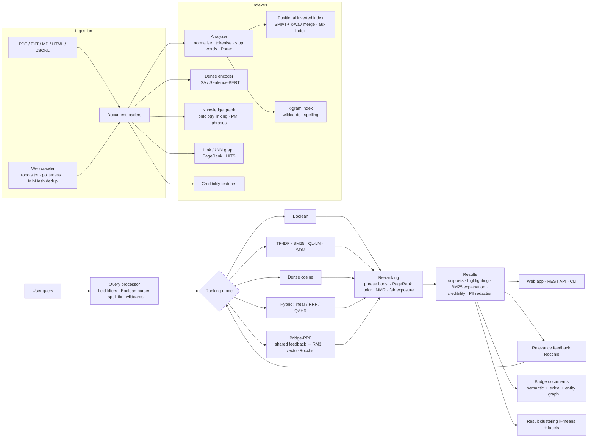

# SearchBridge AI — Architecture



## Bridge-PRF data flow
```mermaid
sequenceDiagram
  participant U as Query q
  participant L as BM25
  participant D as Dense
  participant H as Hybrid fuse(α)
  U->>L: L0 = BM25(q)
  U->>D: D0 = cos(E, v_q)
  L->>H: L0
  D->>H: D0
  H->>H: F = top-k(fuse(L0, D0))
  H->>L: RM3(q, F) → L1
  H->>D: v' = v_q + β·mean(E[F]) → D1
  L->>H: L1
  D->>H: D1
  H-->>U: fuse(L1, D1; α)
```

## Design decisions
| Decision | Why |
|---|---|
| Own inverted index (not Lucene/Elasticsearch) | Course goal: implement and measure indexing, compression and ranking internals |
| Term-at-a-time scoring over postings | Only documents sharing a query term are touched; simple to explain and test |
| Dense side pluggable (LSA ↔ SBERT) | Runs fully offline for grading; upgrades to neural embeddings with one flag |
| Min-max normalisation before linear fusion | BM25 and cosine scores live on different scales (Fox & Shaw, 1994) |
| Same analyzer for index and query | Avoids index/query mismatch (IIR §2.2) |
| Every tuned component evaluated with 5-fold CV over queries | Prevents test-set tuning; numbers in RESULTS.md are honest |
| Explainability built in (BM25 term contributions, credibility reasons, related-doc components) | Responsible IR: users can audit why a result appears |
| Pickle persistence | Single-file index for a prototype; swap for a key-value store at scale |

## Complexity (N docs, T tokens, V vocabulary)
* Index build: O(T log V) (block sort plus merge). Cranfield: about 0.4 s lexical and about 3 s for everything (LSA, KG, PageRank).
* BM25 query: O(Σ df(t)) over the query terms. Dense query: O(N·d) brute force; use FAISS/HNSW above roughly 10⁵ docs.
* Bridge-PRF is about 2× the cost of a hybrid query plus RM3 over k docs. Cranfield latency is about 15 ms per query.

## Version 2: search path with memory
```
browser (sb.js) ── /api/suggest ──▶ Suggester (sorted dictionary + keyphrases + title index, user history, k-anon popular)
      │          ── /api/search ──▶ engine.search(mode="smart", personal=PersonalContext)
      │                               parse → spell-fix → Bridge-PRF relevance (top 200, min-max)
      │                               + PageRank V3 + HITS (real links only) + session context
      │                               + β·gate·p_user (personal/rerank.py) → filters → near-dup folding → hits
      │          ── /api/events ──▶ InteractionStore (SQLite, ~/.searchbridge) ─▶ build_profile (decay, tanh)
      │          ── /api/me ──────▶ what was learned · pause · clear
      └── cookie sb_uid (anonymous, per browser; users never mixed)
crawler: scripts/crawl_web.py → data/web/pages.jsonl.gz → "Web pages" collection (hyperlink graph)
```
