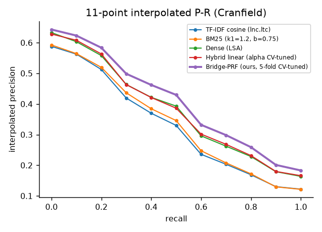
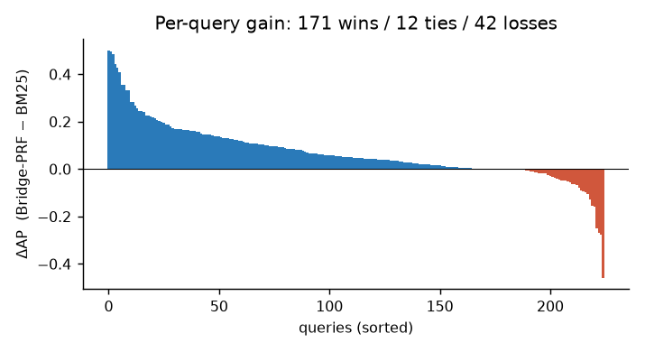
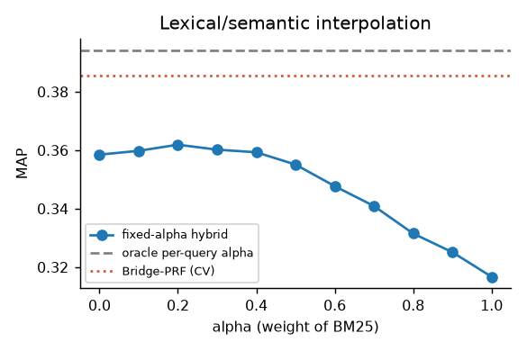
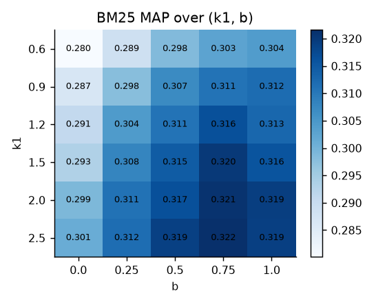
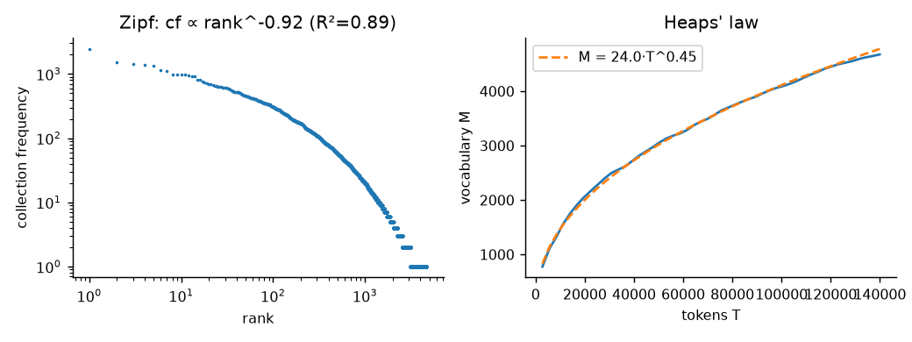
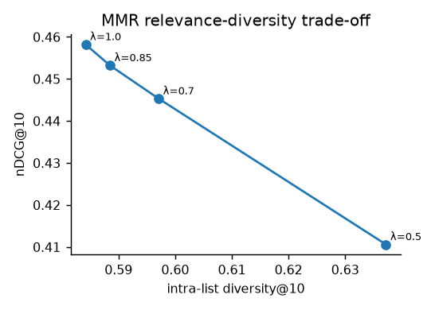

# SearchBridge AI — Experimental Results (Cranfield 1400)

Collection: 1400 documents, 225 judged queries. Dense encoder: **Dense (LSA)**. Ranked runs evaluated to depth 1000. Tuned systems use 5-fold cross-validation over queries. † / ‡ / § = significantly different from BM25 / CV-tuned linear hybrid / dense+vector-PRF (two-sided paired randomisation test on per-query AP, 10k permutations, p < 0.05).

## 1. Retrieval effectiveness

| System | MAP | P@10 | nDCG@10 | MRR | R@100 | BPref |
|---|---:|---:|---:|---:|---:|---:|
| TF-IDF cosine (lnc.ltc) | 0.3080ठ| 0.2351 | 0.3860 | 0.5382 | 0.7603 | 0.2556 |
| BM25 (k1=1.2, b=0.75) | 0.3165ठ| 0.2378 | 0.3909 | 0.5417 | 0.7505 | 0.2650 |
| QL-LM Dirichlet (mu=300) | 0.3024†‡§ | 0.2302 | 0.3814 | 0.5465 | 0.7380 | 0.2719 |
| QL-LM Jelinek-Mercer (lambda=0.7) | 0.2931†‡§ | 0.2244 | 0.3729 | 0.5364 | 0.7358 | 0.2623 |
| SDM / Markov random field (0.85, 0.10, 0.05) | 0.3055†‡§ | 0.2342 | 0.3884 | 0.5604 | 0.7426 | 0.2541 |
| Dense (LSA) | 0.3585†§ | 0.2684 | 0.4354 | 0.5819 | 0.8042 | 0.3008 |
| BM25 + RM3 (self-PRF) | 0.3535†§ | 0.2676 | 0.4286 | 0.5629 | 0.7783 | 0.2862 |
| Dense (LSA) + vector-PRF (self) | 0.3773†‡ | 0.2827 | 0.4524 | 0.5915 | 0.8293 | 0.3150 |
| Hybrid RRF (k=60) | 0.3501†‡§ | 0.2631 | 0.4264 | 0.5706 | 0.7824 | 0.2812 |
| Hybrid linear (alpha CV-tuned) | 0.3592†§ | 0.2720 | 0.4371 | 0.5714 | 0.7977 | 0.2935 |
| **QAHR: QPP-adaptive hybrid (ours, 5-fold CV)** | 0.3570†§ | 0.2716 | 0.4347 | 0.5621 | 0.7946 | 0.2866 |
| **Bridge-PRF (ours, default k=5, alpha=0.3)** | 0.3785†‡ | 0.2924 | 0.4582 | 0.5619 | 0.8196 | 0.3006 |
| **Bridge-PRF (ours, 5-fold CV-tuned)** | 0.3856†‡ | 0.2942 | 0.4640 | 0.5819 | 0.8267 | 0.2913 |

Bridge-PRF (CV) vs BM25 per query (AP): 171 wins, 12 ties, 42 losses.
Oracle per-query alpha upper bound for linear hybrid: MAP 0.3942.

  

## 2. Bridge-PRF ablation (k=5, alpha=0.3)

| Variant | MAP | P@10 | nDCG@10 | MRR | R@100 | BPref |
|---|---:|---:|---:|---:|---:|---:|
| Bridge-PRF (full) | 0.3785 | 0.2924 | 0.4582 | 0.5619 | 0.8196 | 0.3006 |
|   - without lexical RM3 branch | 0.3753 | 0.2853 | 0.4528 | 0.5708 | 0.8183 | 0.3043 |
|   - without dense vector-PRF branch | 0.3659 | 0.2764 | 0.4433 | 0.5712 | 0.8046 | 0.2941 |
|   - self-feedback instead of shared hybrid feedback | 0.3784 | 0.2920 | 0.4569 | 0.5620 | 0.8238 | 0.2957 |
|   - no feedback at all (= hybrid alpha 0.3) | 0.3602 | 0.2724 | 0.4388 | 0.5759 | 0.7966 | 0.2883 |

Grid (MAP): k=3,alpha=0.2: 0.3856, k=3,alpha=0.3: 0.3799, k=3,alpha=0.4: 0.3795, k=3,alpha=0.5: 0.3794, k=5,alpha=0.2: 0.3828, k=5,alpha=0.3: 0.3785, k=5,alpha=0.4: 0.3759, k=5,alpha=0.5: 0.3749, k=10,alpha=0.2: 0.3749, k=10,alpha=0.3: 0.3763, k=10,alpha=0.4: 0.3715, k=10,alpha=0.5: 0.3692

Folds chose: k=3,alpha=0.2, k=3,alpha=0.2, k=3,alpha=0.2, k=3,alpha=0.2, k=3,alpha=0.2

## 3. QAHR — QPP-adaptive fusion weight

Correlation of predicted alpha with oracle alpha: r = 0.084 (predicted alpha mean 0.36 ± 0.08).

| QPP feature | Pearson r with oracle alpha |
|---|---:|
| avg_idf | 0.019 |
| max_idf | -0.061 |
| avg_scq | 0.13 |
| scs | 0.074 |
| qlen | -0.198 |
| oov | 0.017 |
| nqc_lex | 0.17 |
| nqc_dense | 0.198 |
| wig_lex | 0.178 |
| margin_lex | 0.033 |
| margin_dense | 0.022 |
| rbo | 0.051 |

## 4. Boolean retrieval (queries as conjunction / disjunction of terms)

| Operator | Precision | Recall | F1 | Avg. result-set size |
|---|---:|---:|---:|---:|
| AND | 0.0373 | 0.0142 | 0.0182 | 0.1 |
| OR | 0.0085 | 0.9592 | 0.0168 | 897.8 |

## 5. Text-processing ablation (BM25)

| Setting | MAP | P@10 | Vocabulary |
|---|---:|---:|---:|
| stemming=on, stopwords=removed | 0.3165 | 0.2378 | 4676 |
| stemming=on, stopwords=kept | 0.3029 | 0.2333 | 4786 |
| stemming=off, stopwords=removed | 0.2949 | 0.2356 | 7319 |
| stemming=off, stopwords=kept | 0.2789 | 0.2258 | 7436 |

## 6. Index compression & term statistics

| Structure | Bytes | Ratio |
|---|---:|---:|
| Postings, uncompressed (4-byte ints) | 335,808 | 1.0 |
| Postings, gaps + Variable-Byte | 91,755 | 0.273 |
| Postings, gaps + Elias-gamma | 81,097 | 0.241 |
| Postings, gaps + Elias-delta | 80,928 | 0.241 |
| Dictionary, fixed-width 20B/term | 93,520 | 1.0 |
| Dictionary, blocked front-coding | 36,738 | 0.393 |

Zipf exponent 0.925 (R² 0.89); Heaps k=23.96, b=0.447 (R² 0.998).

## 7. Link analysis: PageRank prior (semantic kNN graph) added to Bridge-PRF

| PageRank weight | MAP |
|---:|---:|
| 0.0 | 0.3785 |
| 0.05 | 0.3777 |
| 0.1 | 0.3762 |
| 0.2 | 0.3726 |

## 8. Responsible IR: diversity & exposure

| MMR λ | nDCG@10 | ILD@10 |
|---:|---:|---:|
| 1.0 | 0.4582 | 0.5842 |
| 0.85 | 0.4532 | 0.5885 |
| 0.7 | 0.4453 | 0.5971 |
| 0.5 | 0.4106 | 0.6372 |

Venue exposure in Bridge-PRF top-10 vs share of corpus:

| Venue group | Corpus share | Exposure share |
|---|---:|---:|
| Other / unknown | 0.226 | 0.232 |
| NACA report (US) | 0.128 | 0.122 |
| Journal / proceedings | 0.443 | 0.415 |
| ARC/RAE report (UK) | 0.104 | 0.113 |
| NASA report (US) | 0.099 | 0.117 |

## 9. Text classification (venue, 5-fold CV) & clustering

| Classifier | Accuracy | Macro-F1 |
|---|---:|---:|
| Multinomial Naive Bayes | 0.6695 | 0.5717 |
| Rocchio (nearest centroid) | 0.6362 | 0.551 |
| kNN (k=5, cosine) | 0.6722 | 0.5762 |
| Majority-class baseline | 0.5725 | – |

| Clustering (dense vectors) | Purity | NMI |
|---|---:|---:|
| k-means (spherical, k=4) | 0.5725 | 0.0448 |
| HAC average-link (k=4) | 0.5725 | 0.0196 |
| HAC complete-link (k=4) | 0.5725 | 0.0111 |

Topical clustering: 179 documents from the relevant sets of 8 queries with disjoint judgements (gold topic = query).

| Method | Purity | NMI |
|---|---:|---:|
| k-means on LSA vectors | 0.7877 | 0.7153 |
| HAC average-link on LSA vectors | 0.4078 | 0.4185 |
| HAC complete-link on LSA vectors | 0.6536 | 0.6191 |
| k-means on tf-idf vectors | 0.6872 | 0.5597 |
| HAC average-link on tf-idf vectors | 0.4078 | 0.425 |
| HAC complete-link on tf-idf vectors | 0.2179 | 0.0 |
| random assignment (baseline) | 0.2849 | 0.0675 |
